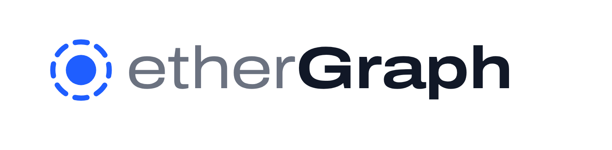
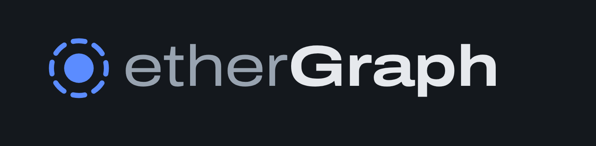
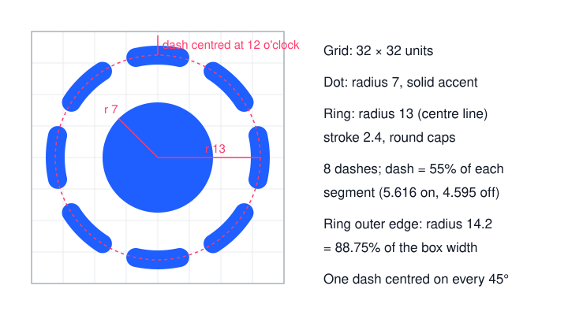
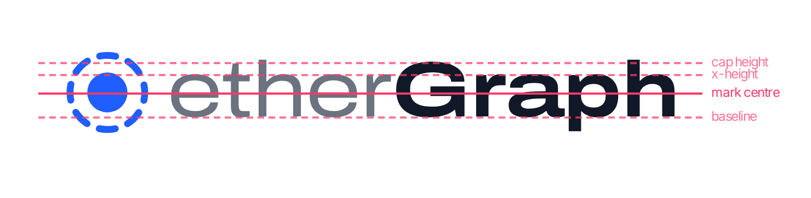

# etherGraph 品牌指南

这份文档定义 etherGraph 的标志、品牌字体和两者的组合方式，以及它们在浅色、深色主题下的用法。界面里的实现（`web/src/shell/Brand.tsx`、`web/src/styles/tokens.css`、`web/public/favicon.svg`）以本文档为准；改动其中任何一处，都要同步修改本文档。

## 1. 概念

标志由一个实心圆和一圈同心虚线环组成，取自 etherGraph 图中最核心的画面：

- **实心圆**是正在调查的中心地址。图里的中心节点就是一个强调色实心圆。
- **虚线环**是围绕它、尚待展开的交易对手。虚线表示"关系存在，但还没有全部取回"，这也是应用里"未同步"节点的视觉语言。

字标 `etherGraph` 用两种字重区分两个部分：`ether`（链上数据）用常规字重和次要文字色，`Graph`（我们提供的关系视图）用粗体和主文字色。

## 2. 标志构造

标志画在 32 × 32 单位的网格上：

| 部分 | 数值 |
|---|---|
| 实心圆 | 圆心 (16, 16)，半径 7，强调色填充 |
| 虚线环 | 圆心 (16, 16)，中线半径 13，线宽 2.4，圆头端点 |
| 虚线分段 | 8 段，均分圆周；每段中实线占 55%（`stroke-dasharray: 5.616 4.595`） |
| 虚线起点 | 每 45° 一段实线，其中一段正对 12 点钟方向（`stroke-dashoffset: 23.228`） |
| 可见外径 | 虚线环外缘半径 14.2，即方框宽度的 88.75% |

- SVG 圆的描边从 3 点钟方向开始、顺时针绘制，所以偏移量等于"半段实线 + 四分之一圆周"，这样 12 点钟方向正好落在一段实线的正中。
- 8 段的设计在 16px 网页图标里仍能看出是虚线；段数更多时，小尺寸下会糊成实线环。
- 现成文件：[`mark-light.svg`](mark-light.svg)（浅色背景用）、[`mark-dark.svg`](mark-dark.svg)（深色背景用）。

## 3. 颜色

标志只用一种颜色，即界面的强调色 token `--accent`：

| 主题 | 颜色 | 用途 |
|---|---|---|
| 浅色 | `#1f5eff` | 白色或浅灰背景 |
| 深色 | `#5b8cff` | 深色背景（`#14181d` 等） |

- 实心圆和虚线环永远同色，不用渐变、阴影、描边或第二种颜色。
- 在单色场合（打印、刻印），可以整体使用主文字色：浅色主题 `#111827`，深色主题 `#e6e9ed`。
- 字标颜色跟随主题 token：`ether` 用 `--fg-muted`，`Graph` 用 `--fg`。

## 4. 品牌字体

字标使用 **Archivo Expanded**：Archivo 可变字体，宽度轴 `wdth` 取 125%。

| 项目 | 规定 |
|---|---|
| 字体文件 | `@fontsource-variable/archivo` 的 `wdth.css`（字族名 `Archivo Variable`），随应用本地打包，不依赖外网 |
| 宽度 | `font-stretch: 125%` |
| `ether` | 字重 400，颜色 `--fg-muted` |
| `Graph` | 字重 700，颜色 `--fg` |
| 字距 | `-0.01em` |
| 写法 | 永远是 `etherGraph`：小写 e，大写 G，中间没有空格、点或连字符 |

- Archivo Expanded 只用于品牌字标。界面正文仍然用 Inter，数字和地址用 IBM Plex Mono。
- 字体加载完成前，字标暂时显示为 Inter，加载后自动替换。

## 5. 组合标志（标志 + 字标）

组合标志的所有尺寸都按字标字号的 em 定义，因此在任何字号下比例都一样。下表中的字形参数是在浏览器里对实际渲染结果逐像素量出来的：

| 字形参数（Archivo Expanded） | 数值 |
|---|---|
| 大写高度（H） | 0.69em（G 的圆形超出到 0.70em） |
| x 高度（x） | 0.525em（e 为 0.54em） |
| 上伸部（h） | 0.725em |
| 下伸部（p） | 0.165em |

对齐规则：

1. **大小**：标志的可见外径等于大写高度的 1.5 倍（1.035em）。可见外径只占 SVG 方框的 88.75%，所以方框边长为 1.166em。
2. **间距**：虚线环外缘到 `e` 的视觉距离等于大写高度的 0.4 倍。减去方框内边距和 `e` 的左侧边距后，CSS 外边距为 0.16em。
3. **垂直对齐**：标志中心对准大写高度中线与 x 高度中线的中点，即基线上方 0.305em。字标几乎都是小写，只有一个大写 G：对准大写高度会让标志在 `ether` 旁边偏高，对准 x 高度又会在 G 旁边偏低，取中点在视觉上最平衡。

实现方式：组合标志是一个 `align-items: center`、`line-height: 1` 的 flex 容器，文字中心落在基线上方 0.335em，标志再用 `top: 0.03em` 下移到 0.305em。对应的 token：

| Token | 值 | 含义 |
|---|---|---|
| `--font-brand` | `'Archivo Variable', 'Archivo', var(--font-sans)` | 品牌字体 |
| `--fs-brand` | `15px` | 顶栏字标字号 |
| `--fs-brand-login` | `28px` | 登录页字标字号 |
| `--brand-mark` | `1.166em` | 标志方框边长 |
| `--brand-gap` | `0.16em` | 标志与字标的间距 |
| `--brand-nudge` | `0.03em` | 标志下移量 |
| `--lh-brand` | `1` | 行高（下移量以此为前提） |

## 6. 安全区与最小尺寸

- **安全区**：组合标志四周至少留出一个标志可见外径的一半（约 0.5em），这片区域内不放其他文字、图标或边框。顶栏里的现有间距满足这一要求。
- **最小尺寸**：
  - 单独的标志不小于 16px（网页图标尺寸）；
  - 组合标志的字号不小于 13px，再小时 `ether` 的细笔画会发虚，这时改用单独的标志。

## 7. 网页图标

- 文件：`web/public/favicon.svg`，由 `web/index.html` 引用。
- 默认使用浅色强调色，并通过 `@media (prefers-color-scheme: dark)` 在系统深色模式下换成深色强调色，以适配浏览器标签栏的背景。
- 网页图标是独立的静态文件，几何参数和颜色是从 `Brand.tsx` 和 `tokens.css` 复制过去的；`web/src/shell/Brand.test.tsx` 会检查两者一致，改了其中一处而忘了另一处，测试会失败。

## 8. 不要这样做

- 不要改变实心圆和虚线环的比例、虚线段数或线宽，也不要把虚线环换成实线。
- 不要旋转标志（虚线环有一段必须正对 12 点钟）。
- 不要给标志加渐变、阴影、外发光，也不要让两部分使用不同颜色。
- 不要把字标拆成两行，不要在 `ether` 和 `Graph` 之间加空格、点或连字符，也不要写成 `EtherGraph`、`ethergraph` 或 `ETHERGRAPH`。
- 不要用 Archivo 以外的字体，或 125% 以外的宽度来排字标。
- 不要把标志放在字标右侧或上方。
- 不要在低对比度背景上使用：浅色强调色只放在浅色背景上，深色强调色只放在深色背景上。

## 9. 实现位置

| 文件 | 内容 |
|---|---|
| `web/src/shell/Brand.tsx` | `BrandMark`（标志）、`BrandLockup`（组合标志）及几何常量 |
| `web/src/shell/Brand.test.tsx` | 几何、可访问名称，以及网页图标与组件一致性的测试 |
| `web/src/styles/tokens.css` | 品牌 token（第 5 节） |
| `web/src/styles/app.css` | `.brand`、`.brand__mark`、`.brand__ether`、`.brand__graph`、`.topbar__logo`、`.login__brand` |
| `web/src/auth/LoginPage.tsx` | 登录页上的组合标志 |
| `web/src/main.tsx` | 引入 `@fontsource-variable/archivo/wdth.css` |
| `web/public/favicon.svg` | 网页图标 |
| `docs/brand/` | 本文档和文中的图片、SVG 素材 |

本文档中的组合标志 PNG 是从应用里实际渲染后截图生成的。改动品牌实现后，请重新截图替换。
